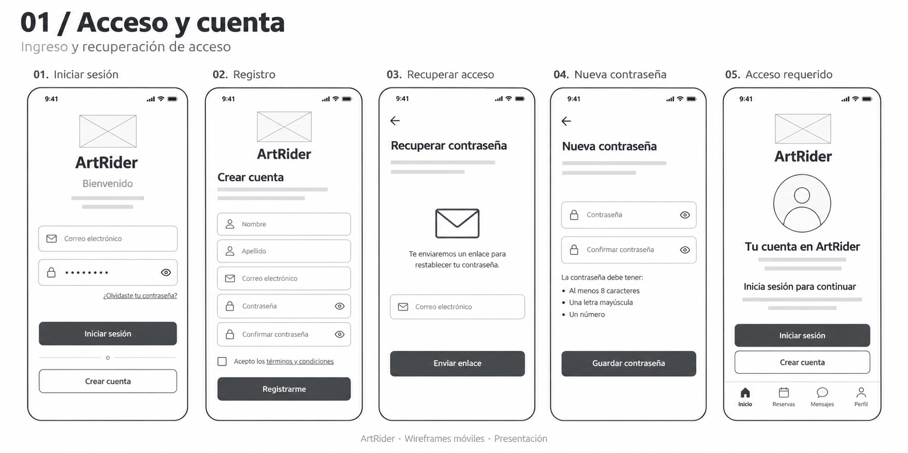
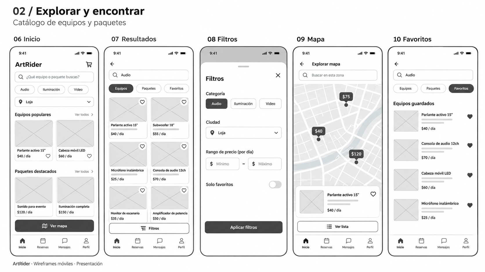
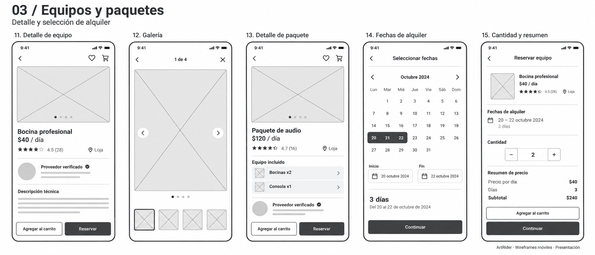
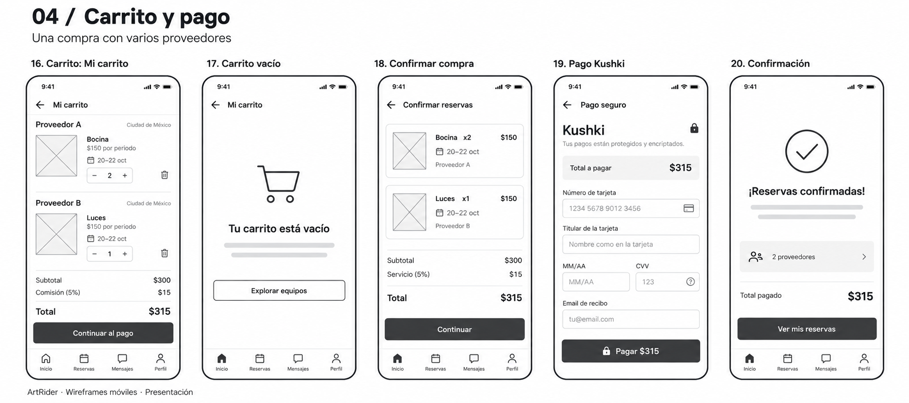
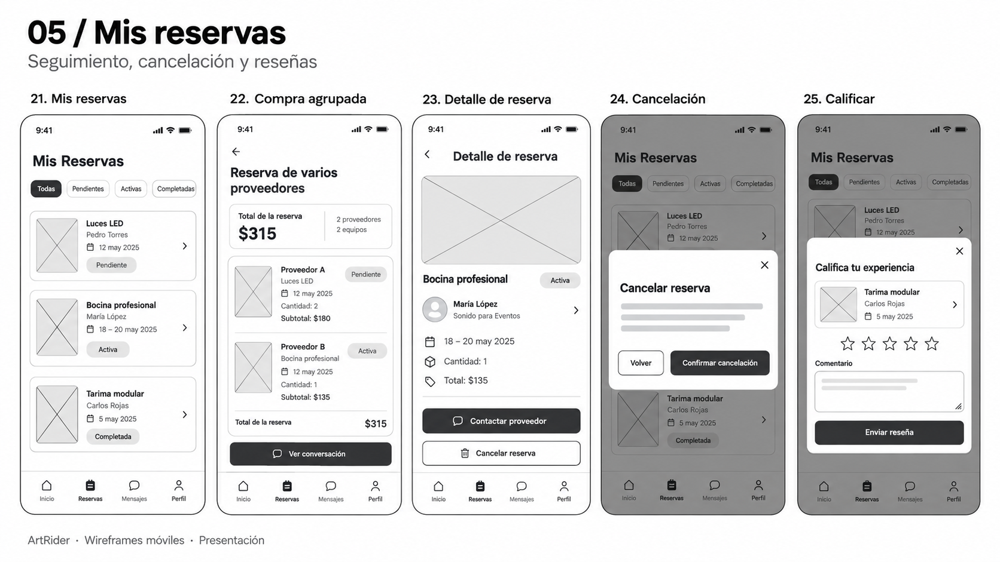
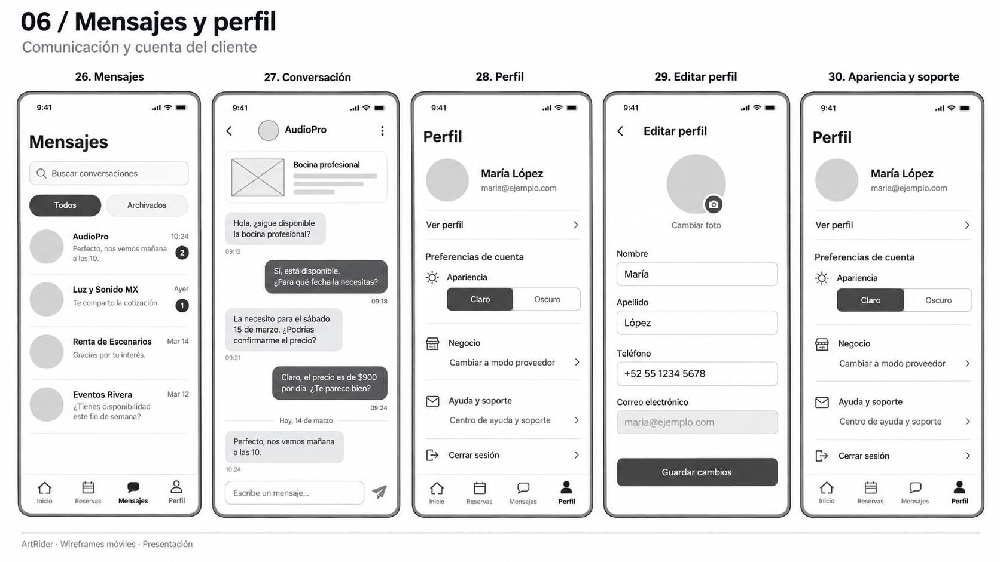
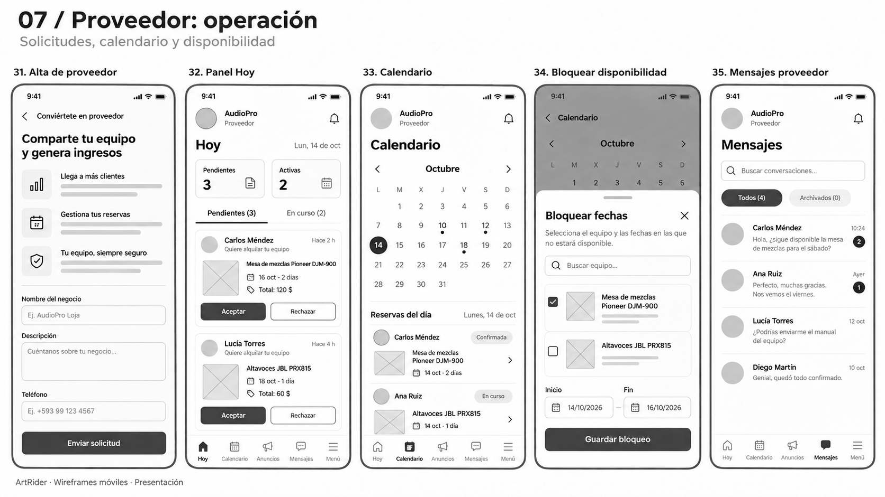
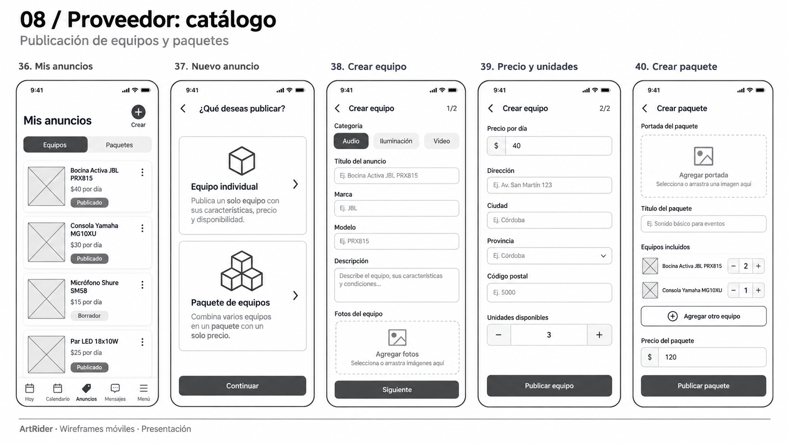
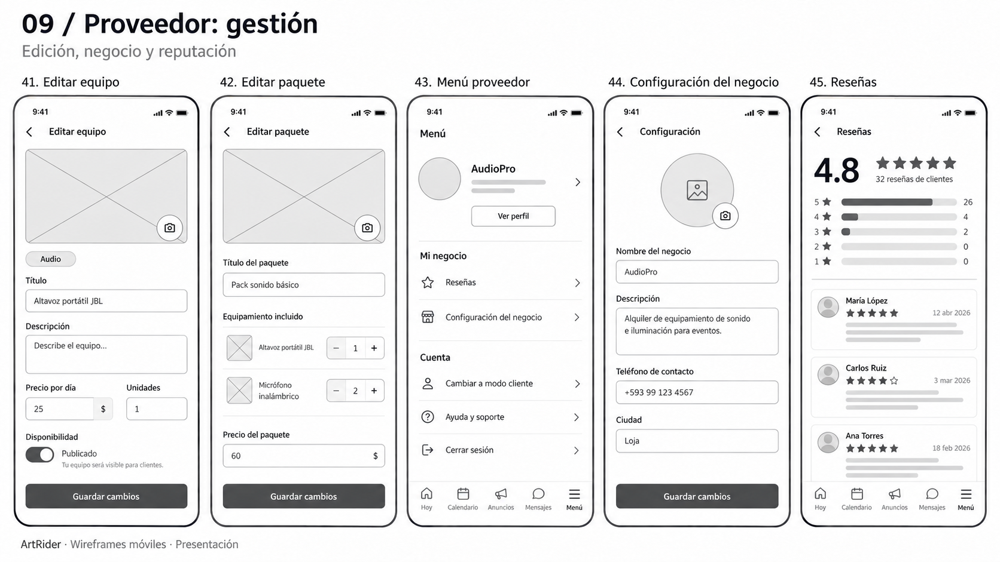

# ArtRider: wireframes móviles

9 láminas PNG, 45 pantallas y estados, para presentación. Interpretación de baja fidelidad basada en artrider-mobile/src; no son capturas exactas ni especificaciones funcionales. Los nombres, precios, fechas, teléfonos y ciudades son datos ilustrativos. Algunos formularios largos se dividen en vistas para facilitar la exposición. Los cuadros con X representan fotografías.

Cliente: acceso → exploración → equipo o paquete → fechas y cantidad → carrito → pago Kushki → reservas → mensajes y reseñas.
Proveedor: alta → panel Hoy → calendario → disponibilidad → anuncios → crear o editar equipo/paquete → configuración y reseñas.

No se ha modificado el código de la aplicación. No se representa Advisory ni administración web como pantallas nativas existentes.

## Índice

### 01 / Acceso y cuenta

- 01 Iniciar sesión
- 02 Registro
- 03 Recuperar acceso
- 04 Nueva contraseña
- 05 Acceso requerido

### 02 / Explorar y encontrar

- 06 Inicio
- 07 Resultados
- 08 Filtros
- 09 Mapa
- 10 Favoritos

### 03 / Equipos y paquetes

- 11 Detalle de equipo
- 12 Galería
- 13 Detalle de paquete
- 14 Fechas de alquiler
- 15 Cantidad y resumen

### 04 / Carrito y pago

- 16 Carrito
- 17 Carrito vacío
- 18 Confirmar compra
- 19 Pago Kushki
- 20 Confirmación

### 05 / Mis reservas

- 21 Mis reservas
- 22 Compra agrupada
- 23 Detalle de reserva
- 24 Cancelación
- 25 Calificar

### 06 / Mensajes y perfil

- 26 Mensajes
- 27 Conversación
- 28 Perfil
- 29 Editar perfil
- 30 Apariencia y soporte

### 07 / Proveedor: operación

- 31 Alta de proveedor
- 32 Panel Hoy
- 33 Calendario
- 34 Bloquear disponibilidad
- 35 Mensajes proveedor

### 08 / Proveedor: catálogo

- 36 Mis anuncios
- 37 Nuevo anuncio
- 38 Crear equipo
- 39 Precio y unidades
- 40 Crear paquete

### 09 / Proveedor: gestión

- 41 Editar equipo
- 42 Editar paquete
- 43 Menú proveedor
- 44 Configuración del negocio
- 45 Reseñas

## Generación

Herramienta integrada image_gen (sin CLI). Prompts finales archivados en PROMPTS.md.

